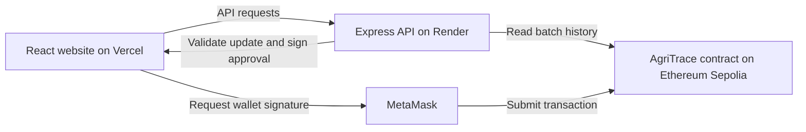

# AgriTrace project workflow

AgriTrace records how a produce batch moves from farm to shelf. Partners record handovers and conditions, regulators review issues and issue recalls, and consumers can scan a batch QR code to see its history.

## How the project works



For a write, the participant signs into a role account and submits a batch action. The API checks rules such as who holds the batch or who may recall it, then signs an approval. MetaMask signs and sends the participant’s transaction. The Solidity contract checks the approval and current record version before saving the update. The app waits for a mined receipt and refreshes the batch. Public QR pages read the history without requiring a wallet.

## Run locally

Install Node.js 22.12+ in the 22.x series or Node.js 24. Run commands from the repository root.

### Quick start with seeded records

```sh
npm ci
npm run build
npm run start:demo
```

With the default local settings, open [localhost:4000](http://127.0.0.1:4000), select a classroom account, and use `agritrace-demo`. This mode stores records in a local JSON file and needs no wallet. For frontend development with live reload, run `npm run seed` once, then `npm run dev` and open the Vite URL printed in the terminal.

### Local blockchain with MetaMask

1. Run `npm ci` if dependencies are missing. Start the local chain with `npm run blockchain` and leave it running.
2. In a second terminal, run `npm run build`, then `npm run start:ethereum`. Stop any previous AgriTrace API running on port 4000 first.
3. Open [localhost:4000](http://127.0.0.1:4000). In MetaMask, import the generated **local test account** for your role using the details in `.local/wallet-import.txt`. Connect to **AgriTrace Local** using RPC `http://127.0.0.1:8545`, chain ID `1337`, and currency `ETH`.
4. Sign in with `agritrace-local` or your configured local password. A new chain starts empty, so register a batch as the farmer. When changing roles, switch both your AgriTrace account and your MetaMask account. [Full local Ethereum setup](docs/ETHEREUM.md)

## Walk through the supply chain

1. The **farmer** registers a synthetic batch. Transfer custody through the **mandi agent**, **transporter**, **warehouse**, and **retailer**. Sign in as the current holder for each handover.
2. While the transporter holds the batch, record a simulated reading of **25°C** against the default **15°C** maximum. Open **Cold chain** to see the alert.
3. As a participant, report an issue. Sign in as the **regulator** to review it, recall the batch, and record a resolution. The recall remains in force after the complaint is resolved.
4. Open **Batch QR** to see the consumer view. In **Verification**, select **Simulate an edit** to see a copied event fail its Merkle proof, then select **Restore original**. In Ethereum mode, **Performance** shows gas from receipts and confirmation times measured by the browser for new submissions.

The hosted [AgriTrace website](https://agri-trace-psi.vercel.app/) already has a [tomato batch recorded on Sepolia](https://agri-trace-psi.vercel.app/trace?batch=meerut-tomatoes). Use your registered MetaMask wallet and Sepolia test ETH for hosted updates. The batch trace and integrity check are available without signing in.

## Check and deploy changes

```sh
npm test
npm run build
npm run smoke
```

GitHub Actions runs the project checks on pushes and pull requests. Vercel deploys frontend pushes to `main` and forwards `/api` requests to Render. Backend changes require a Render deployment under its own deployment settings. The existing Sepolia settings and server approval key belong on Render. [Deployment setup](docs/VERCEL.md)
