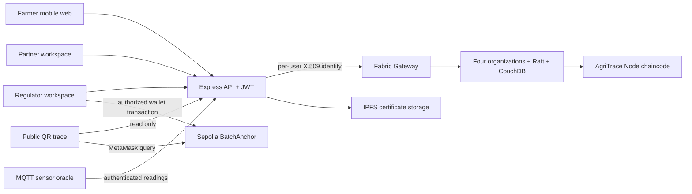

# Architecture and synopsis mapping

`LEDGER_MODE=demo` replaces the Gateway with an atomic local file store. It executes the same shared domain rules, but the local store is neither a peer-to-peer network nor a blockchain. Fabric mode fails closed on configuration or network errors.

## Data and rules

A batch holds immutable harvest metadata plus projections for its current quantity, holder, status, certificates and complaints. Every change appends a transaction event. Each event contains an index, actor identity/role, transaction ID, ledger timestamp, previous-event hash and operation data. Validation reconstructs projections to detect edits outside the event stream.

The full batch aggregate is a Fabric state value, so concurrent updates to one batch are checked by Fabric's MVCC validation. In demo mode a single-process queue serializes writes and a temporary file is renamed atomically. Do not run multiple API processes against the demo file.

Fabric chaincode obtains role, display name and enrollment ID from the caller's certificate. Its participant registry is populated by each participant signing `RegisterParticipant`. Recipient names/roles are read from that registry, preventing a direct chaincode caller from inventing a recipient role. The API's public participant list comes from its administrator-managed account configuration. Rotating enrollment IDs or changing roles requires planned ledger and account migration.

Only farmers create batches. Only current holders may hand over an active batch, attach certificates or record conditions (the latter also requires a transporter/processor/retailer role). Regulators recall and resolve complaints. Any authenticated participant can report an issue. Consumers have no mutation route. A recall is final in this prototype; complaints may still be reported or resolved after recall.

## Hashing specification

1. Serialize JSON recursively with lexicographically sorted object keys and original array order; no whitespace.
2. Event leaf = lowercase hex `SHA256(canonical(event))`.
3. Compare two child digests as bytes; concatenate their lowercase hex strings in ascending order; parent = `SHA256(that 128-character UTF-8 string)`.
4. Duplicate an unpaired child at every level. Empty list root = `SHA256('')` (batches themselves always have a harvest event).
5. Verify an inclusion proof by repeatedly combining the leaf with its sibling using the same sorted-pair rule.

This encoding is intentionally documented: a library which hashes concatenated raw digest bytes will produce a different root. Event order is bound by each leaf's index and previous-event hash, even though tree pairs are sorted. An externally trusted historical root is necessary to detect an attacker recomputing the entire history. The local demo cannot supply that external trust by itself.

## Scope against the synopsis

| Synopsis item | Delivery |
|---|---|
| Farm batch, quantity, date, GPS and declaration | Implemented |
| Current-holder smart-contract rules | Shared domain + Fabric chaincode, with recipient registry |
| Sensor oracle, temperature/humidity limits | API, simulator and MQTT gateway; hardware not used |
| Certificates on IPFS, hashes on ledger | Implemented integration; requires running Kubo |
| QR consumer map and timeline | Implemented; map uses OpenStreetMap tiles |
| Regulator audits, complaints and recalls | Implemented |
| Price transparency | INR/kg per event; differences shown, not profit |
| Merkle roots and Ethereum anchor | Implemented contract, scripts and wallet UI; requires Sepolia deployment |
| Four Fabric organizations, Raft, CA, CouchDB | Generator and enrollment/deployment scripts supplied; live network unverified here |
| React/mobile PWA | Responsive React portal and PWA manifest; no offline cache/queue |
| MongoDB quick-search index | Not needed for the small prototype: authorized queries search ledger batches directly. No MongoDB service is implemented. |
| Optional lot merge/split | Not implemented; custody supports one conserved batch ID with recorded weight loss. Genealogy for merged/split batches is a proposed extension. |
| Transaction performance measurements | No network throughput claim. Unit/API checks measure correctness; benchmark a running Fabric network separately. |

## Security and deployment limits

- Demo mode defaults to loopback. Change HOST only for a controlled demonstration; known demo credentials are unsuitable for public hosting.
- Passwords are salted with scrypt; JWTs use HS256, issuer/audience checks, a two-hour expiry, and an administrator-controlled secret in Fabric mode. Browser tokens are kept in session storage. There is no password recovery or account-management UI.
- The API is a trust boundary holding participants' private keys. Protect that server and its trusted accounts file. Moving signing into separate organizational gateways would improve organizational independence.
- Public traces deliberately expose recorded actor names, checkpoints, prices and certificate metadata. Use synthetic data for demonstrations. Real deployment requires a privacy and commercial-data policy.
- All four peer organizations can read channel state. No private data collection or encrypted certificate store is implemented.
- The network is a development topology: one orderer, development secrets, loopback enrollment CAs and host Docker socket access for chaincode builds. It is not a production network template.
- A SHA-256 digest detects file changes, not false lab claims. Identity verification, accredited certificate checks and hardware-backed sensor provenance are not included.
- Aggregate state grows with events (capped at 5,000 events per batch); query pagination, a MongoDB index, telemetry retention and load testing are future scaling work.
- Fabric CA, IPFS, MQTT and the Sepolia network require independent infrastructure and acceptance testing. No real network service or testnet deployment is claimed merely from the existence of its adapter.

## Consensus comparison for the report

Raft elects an ordering leader and tolerates crash faults when a majority of its nodes remains available; it does not protect against a malicious majority or Byzantine orderer behavior. The included single orderer cannot tolerate that orderer's failure. PBFT-style protocols address Byzantine faults with different communication and membership assumptions. Proof of Work expends resources to order an open network, a mismatch for a known-member agricultural consortium. Fabric transaction endorsement and validation are separate from the Raft ordering decision.
